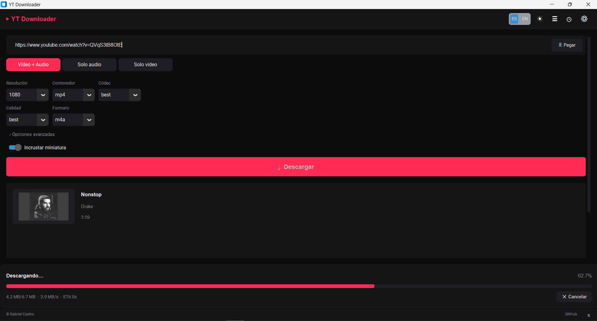

<div align="center">

# ▶ YT Downloader

**Descargador moderno de YouTube · Modern YouTube Downloader**

*Minimalista · Bilingüe · Open Source · Python 2026*

<br/>

[](https://github.com/GabrielCastroV/youtube-downloader/actions/workflows/ci.yml)
[](LICENSE)
[](https://www.python.org/)
[](https://github.com/yt-dlp/yt-dlp)
[](https://github.com/TomSchimansky/CustomTkinter)
[](https://docs.astral.sh/ruff/)

<br/>



</div>

---

## ¿Qué es? / What is it?

**YT Downloader** es una aplicación de escritorio para descargar vídeos y audio de YouTube con una interfaz limpia, moderna y completamente configurable. Construida con Python 3.12+, CustomTkinter y yt-dlp.

**YT Downloader** is a desktop app to download YouTube videos and audio with a clean, modern, fully configurable interface. Built with Python 3.12+, CustomTkinter, and yt-dlp.

---

## ✨ Características / Features

### 🎬 Formatos y calidades / Formats & quality

| Categoría | Opciones |
|-----------|----------|
| **Modos / Modes** | Vídeo + Audio · Solo audio · Solo vídeo · Shorts |
| **Resolución / Resolution** | Mejor · 4K · 1440p · 1080p · 720p · 480p · 360p |
| **Vídeo** | MP4 · WebM · MKV — H.264 · AV1 · VP9 |
| **Audio** | MP3 · M4A · Opus · WAV · FLAC — 96 a 320 kbps |

### 🛠️ Funcionalidades / Functionality

| | |
|---|---|
| 📋 **Cola de descargas** | Multi-descarga con estados en tiempo real |
| 📊 **Progreso en vivo** | Barra siempre visible · % · MB/s · ETA |
| 🕒 **Historial** | SQLite local · re-descarga · abrir archivo |
| 📝 **Subtítulos** | Auto-generados + manuales · embed o `.srt` |
| ✂️ **Recorte** | Por timestamps `mm:ss` |
| 🖼️ **Metadata** | Miniatura + tags ID3/MP4 embebidos |
| 🔁 **Playlists** | Rango de ítems configurable |
| 📁 **Abrir carpeta** | Botón directo al destino al finalizar |
| 🔧 **FFmpeg** | Auto-detección + instalación con 1 clic |
| 🌗 **Temas** | Modo oscuro / claro · toggle instantáneo |
| 🌐 **Bilingüe** | Español / English con persistencia |
| ⌨️ **Atajos** | `Ctrl+Enter` descargar · `Esc` cancelar |

---

## 🚀 Inicio rápido / Quick start

### Requisitos / Requirements

- **Python 3.11+** (3.12 recomendado)
- **[uv](https://docs.astral.sh/uv/)** — gestor de paquetes ultra-rápido

### Instalar uv

```bash
# macOS / Linux
curl -LsSf https://astral.sh/uv/install.sh | sh

# Windows (PowerShell)
powershell -ExecutionPolicy ByPass -c "irm https://astral.sh/uv/install.ps1 | iex"

# o via pip
pip install uv
```

### Clonar y ejecutar / Clone and run

```bash
git clone https://github.com/GabrielCastroV/youtube-downloader.git
cd youtube-downloader
uv sync
uv run yt-downloader
```

> [!TIP]
> En el primer arranque, si FFmpeg no está instalado, la app lo detecta y ofrece instalarlo automáticamente desde el panel de Configuración.

### Alternativa con pip / pip alternative

```bash
pip install customtkinter yt-dlp pillow tkinterdnd2 pydantic platformdirs requests
python -m yt_downloader
```

---

## 🎞️ FFmpeg

FFmpeg es **requerido** para unir pistas, convertir formatos y embeber subtítulos/miniaturas.

| Plataforma | Instalación manual |
|---|---|
| **Windows** | `winget install Gyan.FFmpeg` o [gyan.dev/ffmpeg](https://www.gyan.dev/ffmpeg/builds/) |
| **macOS** | `brew install ffmpeg` |
| **Linux** | `sudo apt install ffmpeg` / `sudo dnf install ffmpeg` |

> [!NOTE]
> La app incluye un botón **"Instalar FFmpeg"** en Configuración que descarga e instala el binario oficial automáticamente — sin salir de la app.

---

## 🗂️ Estructura del proyecto / Project structure

```
youtube-downloader/
│
├── 📄 pyproject.toml              # uv · ruff · mypy · pytest
├── 📄 uv.lock                     # Dependencias reproducibles
│
├── 📁 src/yt_downloader/
│   ├── __main__.py                # Punto de entrada
│   ├── app.py                     # Wiring Config → I18n → UI
│   ├── downloader.py              # Wrapper yt-dlp (cancelable, tipado)
│   ├── metadata.py                # Fetch preview sin descargar
│   ├── config.py                  # Preferencias Pydantic v2 → JSON
│   ├── i18n.py                    # Diccionarios ES / EN
│   ├── exceptions.py              # Jerarquía tipada de errores
│   ├── history.py                 # Historial SQLite (stdlib)
│   ├── queue.py                   # Cola ThreadPoolExecutor
│   ├── ffmpeg_manager.py          # Detect + install binario oficial
│   ├── models.py                  # Dataclasses: VideoInfo · DownloadOptions · ProgressEvent
│   ├── paths.py                   # Dirs cross-platform (platformdirs)
│   └── 📁 ui/
│       ├── theme.py               # Design tokens: colores · spacing · radii
│       ├── icons.py               # Glyphs Unicode + loader Pillow
│       ├── main_window.py         # Ventana raíz CTk
│       └── 📁 components/
│           ├── url_input.py       # Input + paste + auto-paste + debounce
│           ├── preview_card.py    # Thumbnail · título · canal · duración · badges
│           ├── format_selector.py # Mode chips + dropdowns contextuales
│           ├── advanced_panel.py  # Colapsable: subs · recorte · plantilla
│           ├── progress_card.py   # Barra · % · velocidad · ETA · cancel
│           ├── queue_list.py      # Lista con progreso en tiempo real
│           ├── history_drawer.py  # Historial con acciones
│           ├── settings_panel.py  # Configuración completa
│           └── toast.py           # Notificaciones auto-dismiss
│
└── 📁 tests/                      # pytest · 74 tests · coverage core ≥ 80%
```

---

## 🧑‍💻 Desarrollo / Development

```bash
# Instalar dependencias de desarrollo
uv sync --extra dev

# Formatear código
uv run ruff format src tests

# Lint
uv run ruff check src tests

# Chequeo de tipos
uv run mypy src

# Tests
uv run pytest

# Tests verboso sin cobertura
uv run pytest --no-cov -v

# Pre-commit hooks
uv run pre-commit install
uv run pre-commit run --all-files
```

---

## 🤝 Contribuir / Contributing

Las contribuciones son bienvenidas. Lee [`CONTRIBUTING.md`](CONTRIBUTING.md) para:

- Convenciones de código y commits
- Flujo de Pull Requests
- Cómo reportar bugs

Lee [`CODE_OF_CONDUCT.md`](CODE_OF_CONDUCT.md) para el código de conducta.

> [!IMPORTANT]
> Si encuentras un bug o tienes una idea, abre un issue o PR en [GitHub](https://github.com/GabrielCastroV/youtube-downloader).

---

## 📬 Contacto / Contact

<div align="center">

Hecho con ❤️ por **[Gabriel Castro](https://github.com/GabrielCastroV)**

[](https://github.com/GabrielCastroV)
[](https://x.com/avocadostoasted)

</div>

---

## 📄 Licencia / License

<div align="center">

Distribuido bajo la licencia **MIT** — ver [`LICENSE`](LICENSE) para más detalles.

*Distributed under the MIT License — see [`LICENSE`](LICENSE) for details.*

</div>
